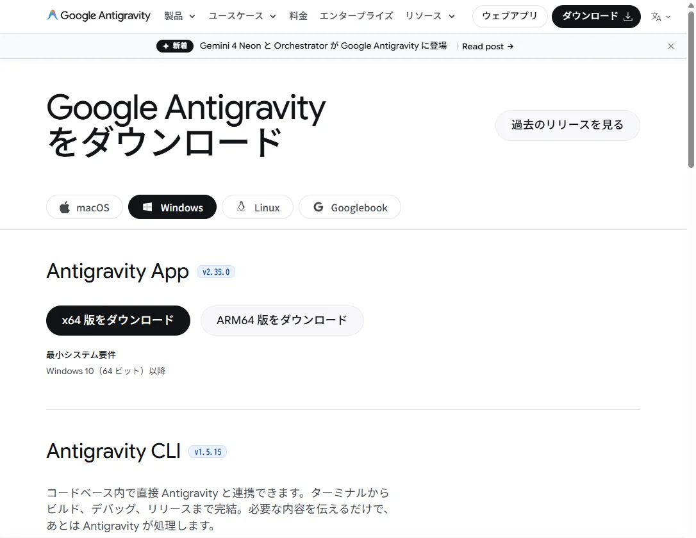
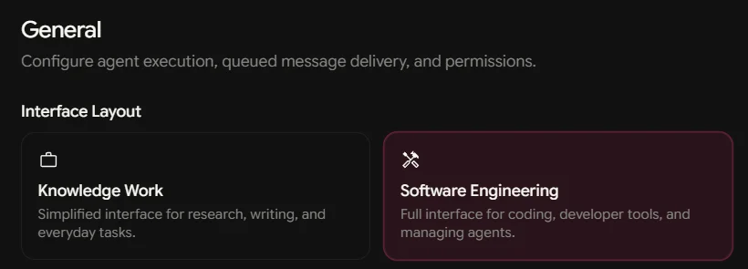
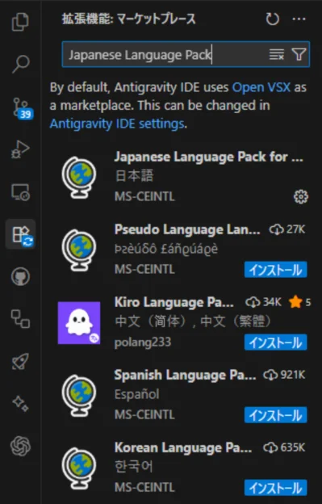
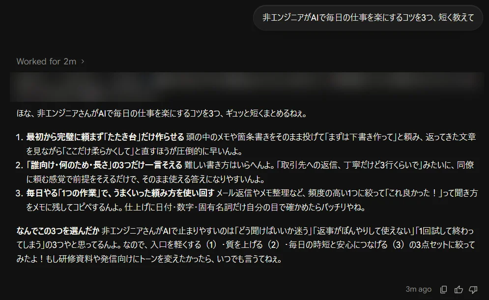
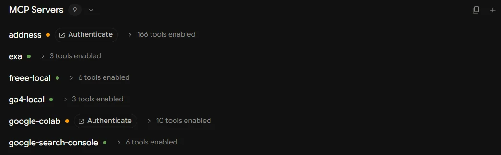

---
# タイトル案:
# 1. Antigravityの使い方。非エンジニアが1年仕事で回した手順と実例（採用）
# 2. Google Antigravityの使い方｜日本語化・料金・非エンジニアの実務例
# 3. Antigravityの使い方と日本語化。無料枠から毎日の仕事で回すまで
#
# 見出し案（H2）:
# - Antigravityの4つの入口。非エンジニアは何から選ぶか
# - インストールと初期設定の手順
# - Antigravityを日本語化する方法（画面表示とAIの返答）
# - 最初の1回を通しで動かしてみる
# - 料金プランと使えるモデル（2026年11月時点）
# - 非エンジニアが毎日の仕事で回している実例
# - 使い続ける中でつまずいた点と対処
# - よくある質問
# - まとめ
slug: antigravity-usage
title: Antigravityの使い方。非エンジニアが1年仕事で回した手順と実例
description: Google Antigravityの使い方を2026年11月時点の公式仕様と1年間の実務記録で解説。AppとIDEの選び方、日本語化、無料枠と最新モデル、CLIやMCPの活用、つまずきまで整理します。
eyebrow: AI実録
answer: 非エンジニアがAntigravityを始めるなら、まず個人のGoogleアカウント（無料）でデスクトップ版のAntigravity Appを入れ、日本語の応答ルールを1つ書いてから小さなファイル整理を1回試す流れが最も迷いません。慣れてきたらCLI（agy）やMCPをつなぐと、毎日の定型作業まで任せられます。
published:
checked: 2026-11-24
pr: false
sources:
  - title: Choose your Antigravity | Google Antigravity Docs
    url: https://antigravity.google/docs/overview
  - title: Get started | Google Antigravity Docs
    url: https://antigravity.google/docs/getting-started
  - title: Google Antigravity - Download
    url: https://antigravity.google/download
  - title: Settings | Google Antigravity Docs
    url: https://antigravity.google/docs/settings
  - title: Rules | Google Antigravity Docs
    url: https://antigravity.google/docs/rules
  - title: Agent skills | Google Antigravity Docs
    url: https://antigravity.google/docs/skills
  - title: Choose a model | Google Antigravity Docs
    url: https://antigravity.google/docs/models
  - title: Plans | Google Antigravity Docs
    url: https://antigravity.google/docs/plans
  - title: Google Antigravity - Pricing
    url: https://antigravity.google/pricing
  - title: Model Context Protocol (MCP) | Google Antigravity Docs
    url: https://antigravity.google/docs/mcp
  - title: CLI commands | Google Antigravity Docs
    url: https://antigravity.google/docs/cli/reference
  - title: Migrating from Gemini CLI | Google Antigravity Docs
    url: https://antigravity.google/docs/cli/gcli-migration
  - title: FAQ | Google Antigravity Docs
    url: https://antigravity.google/docs/faq
  - title: Google AI Pro と Ultra で Gemini 4 Neon などにアクセス | Google
    url: https://gemini.google/jp/subscriptions/?hl=ja
  - title: Google Antigravity のスタートガイド | Google Codelabs
    url: https://codelabs.developers.google.com/getting-started-google-antigravity?hl=ja
---

Google Antigravityは、文章で指示を出すとAIエージェントが計画を立て、手元のファイル編集やコマンド実行、ブラウザでの確認まで進めてくれるプラットフォームです。2025年11月に登場してから形が大きく変わり、2026年5月の2.0以降はアプリ・IDE・CLI・SDKの複数の入口が並ぶ構成になりました。

私はコードをほとんど書けない非エンジニアですが、Web制作やマーケティング、経理まわりの実務で2025年11月からAntigravityを使い続けてきました。作業記録に残っているだけでも2026年11月までに159日分あり、直近の6か月（2026年6月〜11月）では81日分の業務で使っています。

この記事では、2026年11月時点の公式ドキュメントで確かめたインストール・日本語化・料金・最新モデルの仕様と、私が1年間毎日の仕事で回して見えた使い方やつまずきをまとめて紹介します。

## Antigravityの4つの入口。非エンジニアは何から選ぶか

Antigravityを使い始めるときに最初につまずきやすいのが、「どれを入れればよいのか」という点です。2025年11月ごろの記事はVS Codeに似たエディタ画面だけを前提に書かれていますが、2026年11月時点の公式ドキュメントでは次の入口に分かれています。

| 入口 | 何をするためのものか | 向いている場面 |
|---|---|---|
| Antigravity App | エージェントに仕事を任せ、計画や成果物を確認するデスクトップアプリ（コードエディタ無し） | 非エンジニアの最初の1歩、調べもの・文章作成・複数タスクの並行管理 |
| Antigravity IDE / IDE拡張 | エディタの中で補完（Tab）やエージェントを使う開発環境（VS Code・JetBrains等の拡張もあり） | ファイルの中身を画面で見ながら一緒に編集したいとき、日本語のメニュー表示がほしいとき |
| Antigravity CLI（`agy`） | ターミナルからコマンドで動かす版 | 定期実行やスクリプト組み込み、複数のAIツールを並べて使うとき |
| Antigravity SDK | Pythonのプログラムにエージェントを組み込むための開発キット | 自社アプリや自動処理パイプラインの開発 |

中身のAIエージェントや使えるモデル、ルールやMCPの仕組みは共通で、異なるのは操作する画面だけです。非エンジニアが最初に触るなら、まずは**Antigravity App**から入るのが自然です。

特にApp（v2.30.0以降）では、個人のGoogleアカウントで初回ログインしたときに仕事の種類を選ぶ画面が追加され、**Knowledge Work**と**Software Engineering**の2種類のレイアウトを切り替えられるようになりました。Knowledge Workを選ぶと、Gitのブランチ操作やターミナル、コード差分の細かい表示が隠れ、会話とフォルダ内の文書・成果物に集中できる画面になります。あとからSettingsのGeneralにあるInterface Layoutでいつでも切り替えられます。

一方、メニュー表示そのものを日本語にしたい場合や、フォルダ内のテキストファイルを横で開きながら編集したい場合は、VS Codeベースの**Antigravity IDE**の方が馴染みやすい場面もあります。私はIDEから使い始め、途中でAppやCLI（`agy`）へと広げてきました。

## インストールと初期設定の手順

Antigravityはブラウザ上のチャットではなく、手元のPCにインストールして使うソフトです。公式のGet startedに記載されている対応OSは、2026年11月時点で次のとおりです。

- Windows: Windows 10（64ビット）またはWindows 11（x64 / ARM64）
- macOS: Antigravity AppはmacOS 13（Ventura）以降、Antigravity IDEはmacOS 12（Monterey）以降（Apple Silicon / 64ビットIntel）
- Linux: glibc 2.28以上、glibcxx 3.4.25以上（Ubuntu 20以降、Debian 10以降、Fedora 36以降など）

利用には**18歳以上のGoogleアカウント**が必要です。日本は公式FAQの対象地域に含まれています。ただし、会社や学校の独自ドメインで管理されているGoogle Workspaceアカウントは個人のAIプランの対象外となり、既定ではごく限られた枠しか使えないか、管理者の設定によってはサインインできません。試すときは個人のGmailアカウントで始めるのが確実です。

### Antigravity Appの導入手順

1. [公式のダウンロードページ](https://antigravity.google/download)を開き、使っているOSのインストーラーをダウンロードする（Windowsの一般的なPCはx64の`.exe`、MacはApple SiliconまたはIntelの`.dmg`）
2. Windowsは`.exe`を実行してウィザードどおりに進める。Macは`.dmg`を開き、AntigravityをApplicationsフォルダへドラッグする
3. アプリを起動して個人のGoogleアカウントでサインインする
4. 初回起動時に仕事の種類を聞かれたら、非エンジニアの業務なら**Knowledge Work**を選ぶ（コード作業も見るならSoftware Engineeringを選ぶ）
5. 利用規約とデータの取り扱い（Terms & Data Use）を確認して完了する





### 使い始める前に確認しておきたい2つの設定

セットアップが終わったら、業務の資料を触らせる前に左下のSettingsから次の2点を確認しておきます。

1つ目は**データの学習利用のオプトアウト**です。個人のGoogleアカウントで利用する場合、設定のAccountにある**Enable Telemetry**がオンになっていると、やり取りの記録がAntigravityやモデルの改善に使われます。公式FAQにも設定画面からいつでもオフにできると明記されているため、仕事で使う前にオフにしておくと安心です（なお、オフにしてもサービス提供や安全確認のための処理は残るため、パスワードや顧客の機密情報をそのまま貼り付けない運用は別に守ります）。

2つ目は**権限（Permission Preset）**です。SettingsのGlobal Permissionsでは、エージェントがファイル編集やコマンドを実行するときにどこまで確認を挟むかを`Request Review`・`Default`・`Auto`・`Turbo`から選べます。慣れないうちは勝手にコマンドが走らない`Default`または`Request Review`のままにしておき、確認のメッセージを読みながら進める方が事故を防げます。

## Antigravityを日本語化する方法（画面表示とAIの返答）

「Antigravity 日本語化」で調べる人の多くが戸惑うのは、**画面のメニュー表記**と**AIの返答言語**が別々に動いている点です。さらに、App・IDE・CLIのどれを使うかでメニューを日本語にできるかどうかが変わります。

| 対象 | 画面メニューの日本語化（2026年11月時点） | AIの返答・計画書の日本語化 |
|---|---|---|
| Antigravity IDE | 拡張機能（`Japanese Language Pack for Visual Studio Code`）で可能 | ルールファイル（`GEMINI.md` / `AGENTS.md`）で可能 |
| IDE拡張（VS Code等） | エディタ本体の言語設定をそのまま引き継ぐ | ルールファイルで可能 |
| Antigravity App | 公式のSettingsに表示言語の切替項目なし（メニューは英語のまま） | ルールファイルで可能 |
| Antigravity CLI（`agy`） | メニューやヘルプは英語のまま | ルールファイルで可能 |

私は2026年8月にApp（2.0）の画面日本語化を調べた際も、Appには手動の言語切替ボタンがなく、IDE側だけ拡張機能で日本語化できる状態であることを確かめました。AppやCLIはメニューが英語のままでも、入力欄には最初から日本語で指示を出せます。

### 画面メニューを日本語にする手順（Antigravity IDE）

Antigravity IDEはVS Codeをもとに作られているため、次の手順でメニューを日本語に変えられます。私も最初に使い始めた2025年12月にこの手順で英語の壁を下げました。

1. 画面左の拡張機能アイコンを開く（Windowsは`Ctrl+Shift+X`、Macは`Cmd+Shift+X`）
2. 検索欄に`Japanese`と入力し、**Japanese Language Pack for Visual Studio Code**を選ぶ
3. `Install`をクリックし、右下に表示される`Change Language and Restart`を押して再起動する



### AIの返答と計画書を日本語で固定する手順（App・IDE・CLI共通）

メニューよりも実務で困りやすいのは、長いやり取りの途中でAIの返答や実装計画書（Artifacts）が英語に戻ってしまう現象です。これを防ぐには、公式のRulesドキュメントで案内されている**グローバルルールファイル**を1つ作っておきます。

ユーザーのホームディレクトリ配下に`~/.gemini/GEMINI.md`（Windowsならユーザーフォルダ直下の`.gemini\GEMINI.md`。`~/.gemini/AGENTS.md`でも可）というテキストファイルを作り、次のように書くだけでApp・IDE・CLIのすべてに適用されます。

- 回答、実装計画、作業のまとめはすべて日本語で書く
- コマンド名、ファイル名、エラーメッセージの原文は翻訳せずそのまま残す

特定のフォルダだけに適用したいときは、その作業フォルダ直下に`AGENTS.md`または`GEMINI.md`を置きます。もし`.agents/rules/`フォルダの中にルールファイルを分けて置く場合は、先頭に`---`で囲んだYAML frontmatterと`trigger: always_on`（小文字とアンダースコア）を書く必要があります。公式ドキュメントにも、frontmatterが無かったり`alwaysOn`のように表記を間違えたりすると黙って無視されると注意書きがあります。

## 最初の1回を通しで動かしてみる

インストールと日本語の応答ルールが済んだら、いきなり本番の業務フォルダを開かず、練習用のフォルダを作って1回だけ動かしてみます。

1. PCのわかりやすい場所に練習用のフォルダを1つ作り、メモ書きのテキストファイルなどを数件入れておく
2. Antigravity Appの左サイドバーから**New Project**（フォルダに＋が付いたアイコン）→ **Add Folder**でそのフォルダを登録し、**Create**を押す
3. 入力欄に「このフォルダの中にあるファイル一覧と、それぞれの内容を日本語で3行ずつまとめて」と送る
4. エージェントが出した計画や作業結果（Artifacts）を読み、問題なければ承認する

Software Engineeringレイアウトを選んでいる場合、送信前に作業場所として**Local mode**（登録フォルダを直接編集する）と**New worktree mode**（Gitの別作業場所を作って編集する）の選択が出ます。Gitを使っていない普通のフォルダや、Knowledge Workレイアウトでは登録したフォルダ内でそのまま動きます。



### 非エンジニアが最初に覚えた3つの操作だけ

私は2025年12月にAntigravityを使い始めたとき、機能の多さと英語メニューを見て一度立ち止まりました。そのときに全部を覚えるのをやめ、IDEでは次の3つの操作だけを先に使いました。

- **元に戻す（`Ctrl+Z` / `Cmd+Z`）**: AIの編集が意図と違ってもすぐ戻せるため、試すハードルが下がる
- **コマンドパレット（`Ctrl+Shift+P` / `Cmd+Shift+P`）**: メニューの場所を暗記せず、やりたいことを検索して呼び出す
- **チャットで日本語のまま頼む（`Ctrl+L` / `Cmd+L`）**: コマンドを自分で打たず、「このファイルの中身を説明して」「エラーの原因を調べて」と日本語で聞く

Appの操作に当てはめても考え方は同じで、検索パレット（`Ctrl+K`で過去の会話検索、`Ctrl+Shift+P`でコマンド検索）とチャット入力欄（`Ctrl+L`）から始めれば十分です。

## 料金プランと使えるモデル（2026年11月時点）

Antigravityには単独の有料プランがなく、**個人のGoogle AIプラン（Google AI Plus / Pro / Ultra）**に連動して利用枠と選べるモデルが決まります。どのプランでもApp・IDE・CLI・IDE拡張の全機能と無制限のTab補完を使えます。

2026年11月24日時点の公式料金ページおよびGoogleの日本向けプランページで確認した内容は以下のとおりです。

| プラン | 日本の月額（税込） | Antigravityの利用枠 | 枠を超えたとき |
|---|---|---|---|
| 無料（個人アカウント） | 0円 | 週ごとに回復する基本枠 | 回復まで待つ |
| Google AI Plus | 725円 | 無料と同じく週ごとに回復する枠 | 回復まで待つ |
| Google AI Pro | 2,900円 | 5時間ごとに回復する枠（週次上限あり） | 購入済みのAIクレジットで継続可 |
| Google AI Ultra（5x） | 14,500円 | 5時間ごとに回復する上位枠（Proの5倍の使用量上限表示） | 購入済みのAIクレジットで継続可 |
| Google AI Ultra（20x） | 32,000円 | 5時間ごとに回復する最上位枠（Proの20倍の使用量上限表示） | 購入済みのAIクレジットで継続可 |
| 法人（Gemini Enterprise） | Standard/Plusは月30ドル/席〜、または席料0ドルの従量課金 | Google Cloudの規約・管理下で運用 | 契約・予算上限の設定による |

利用枠は「何回送れるか」という固定回数ではなく、エージェントが実行した作業の量に応じて減る仕組みです。簡単な質問なら多く送れ、複数ファイルの編集や長い調査は多く消費します。自分のAPIキーを持ち込んで枠を増やす仕組み（BYOK）には対応していません。ProとUltraで枠を超えたときにAIクレジットを自動消費するかどうかは、Settingsの**AI Credit Overages**で`Never`（使わない）か`Always`（自動で使う）を選べます。

### プラン別に使えるモデル（2026年11月時点）

AntigravityではGoogleのGeminiだけでなく、AnthropicのClaude系モデルも選べます。2026年11月24日時点の公式ドキュメント（Choose a model）に基づく対応は次のとおりです。

| モデル | 無料・Google AI Plus | Google AI Pro | Google AI Ultra | Enterprise |
|---|---|---|---|---|
| Gemini 3.8 Flash | 対応 | 対応 | 対応 | 対応 |
| Gemini 4 Neon | 非対応 | 対応（有料契約・対象端末試用） | 対応 | 対応 |
| Gemini 4 Argon | 非対応 | 対応（有料契約・対象端末試用） | 対応 | 対応 |
| Gemini 4 Hydrogen | 非対応 | 対応（試用除く有料契約） | 対応 | 対応 |
| Gemini 4 Carbon | 非対応 | 非対応 | 対応 | 対応 |
| Orchestrator（計画役＋実行役の自動併用） | 非対応 | 対応（有料契約・対象端末試用） | 対応 | 対応（構成固定） |
| Claude Sonnet 5.5 / Opus 5.5（thinking） | 非対応 | 対応（試用除く有料契約） | 対応 | 対応（管理者有効化） |
| Claude Sonnet 4.6 / Opus 4.6（thinking） | 対応（2026年11月30日削除予定） | 対応（2026年11月30日削除予定） | 非対応 | 非対応 |
| GPT-OSS-120b | 対応（2026年11月30日削除予定） | 対応（2026年11月30日削除予定） | 対応（2026年11月30日削除予定） | 非対応 |

注意点として、**Claude 4.6系とGPT-OSS-120bは2026年11月30日に削除予定**と公式表に明記されています。それ以降、無料プランとGoogle AI Plusで使える推論モデルはGemini 3.8 Flashが中心になります。また、多くのモデルでは推論の深さ（`Low` / `Medium` / `High`、Gemini 4 NeonとHydrogenはさらに`Extra`）を会話ごとに切り替えられます。

迷ったときは、まず無料の個人アカウントでGemini 3.8 Flashを試してみてください。毎日の業務で使うようになり、週次リセットでは足りなくなったり、Gemini 4系やClaude 5.5系を使いたくなったりした段階でGoogle AI Pro（月2,900円）へ上げる流れが無駄がありません。私自身もGoogle AI Proで運用しています。

## 非エンジニアが毎日の仕事で回している実例

インストールして試作を1つ動かすだけでも便利さを感じられますが、Antigravityが本領を発揮するのは毎日の定型業務や調査・確認に組み込んだあとです。ここでは、私が2026年6月〜11月の実務で回してきた4つの使い方を記録にもとづいて紹介します。

### 1. CLI（`agy`）で定型業務の定期実行を回す

Antigravityにはコマンドライン版の**Antigravity CLI（`agy`）**があり、ターミナルから1行で入れられます。

**Windows（PowerShell）**

```powershell
irm https://antigravity.google/cli/install.ps1 | iex
```

**macOS・Linux**

```bash
curl -fsSL https://antigravity.google/cli/install.sh | bash
```

導入後は次のコマンドで確認できます。

```shell
agy --version
```

更新は`npm`ではなく次のコマンドで行います（Go製のネイティブ実行ファイルのため、`npm list -g`には表示されません）。

```shell
agy update
```

私は2026年8月21日に旧Gemini CLIを削除し、`agy`へ完全に切り替えました。

現在、メールの仕分け判定や経理書類の照合・チェック、タスクの最新化といった**定期実行タスク13本**をAntigravity CLIで動かしています（2026年11月24日時点）。11月19日には、当時の12本すべてのモデルを`gemini-4-hydrogen-high`に固定しました。

定期実行をAntigravityに寄せたきっかけは、2026年9月2日の失敗でした。別のAIツールで定期実行を組んだところ、そのツールの既定の最上位モデルが起動して週間利用枠を大きく消費していることに気づいたためです。定期処理はAntigravity CLIに寄せ、判断や長い文章作成が必要な作業だけ別のAIツールを使う分担に変えました。

もう1つ大きな学びは、**全部をAIに丸投げしない構造にする**ことです。2026年9月3日に約800行のJSONデータをそのままAntigravity（Flash）に読ませて集計させたところ、処理が途中で止まりました。そこで、データの取得と結果の反映は決まったスクリプトに固定し、Antigravityには「1件あたり約12行に圧縮したメールを見て、返信要・タスク・情報のみを判定する」工程だけを渡す3段構造へ改めました。その結果、同日の実測では40件の判定で誤判定ゼロになり、それ以降も安定して動いています。

なお、スクリプトなどから対話なしで1回だけ実行したいときは次のコマンドを使います。

```shell
agy -p "指示内容"
```

ただし、作業フォルダにルールファイルを置いている環境では起動時の読み込み確認で止まり終了コード1で落ちることがありました（2026年8月21日実測）。自動化で使う場合は、確認を飛ばす`--dangerously-skip-permissions`オプションと、「スクリプトが触れる範囲や書き出し先を限定する安全設計」をセットで組む必要があります。

### 2. MCPで外部サービスのデータに直接つなぐ

**MCP（Model Context Protocol）**は、AIエージェントが外部サービスのデータを直接読み書きするための共通規格です。Antigravity Appならサイドバーの`Customizations` → `Installed` → `MCP Servers`から一覧で追加でき、IDEならMCP Store、CLIなら`/mcp`コマンドで管理できます。設定ファイルは公式ドキュメント上、全体共通が`~/.gemini/config/mcp_config.json`、作業フォルダ専用が`<作業フォルダ>/.agents/mcp_config.json`です。Antigravityは既定で**Lazy loading**（必要なときだけツールの仕様書を読み込む方式）を採用しているため、複数のMCPをつないでも毎回の消費トークンを抑えられます。

私の業務環境では、2026年7月〜11月にかけてアクセス解析（GA4・Google Search Console）、ドキュメント管理（Notion）、Web検索（Exa）、ローカルで動かしている会計ソフト連携などをMCPでつなぎました。手作業でCSVを書き出してチャットに貼る手間がなくなり、期間比較の分析レポート作成や取引データの確認を会話の流れで進められます。



### 3. ルールとスキルをフォルダに置いて育て直す

毎回チャット欄に「です・ます調で書いて」「この手順で分析して」と打つのは手間がかかります。Antigravityは作業フォルダの`.agents/rules/`（旧`.agent/rules/`も互換対応）や`.agents/skills/<スキル名>/SKILL.md`を自動で読み込むため、仕事の型をMarkdownファイルで置いておけます。

公式のドキュメントでも、**常に守る制約はルール、複数ステップの手順書はスキル**に分ける使い方が案内されています。私の作業フォルダには2026年11月時点でルールを12個、スキルを34個置いてあり、日本語の技術記事の文章規範やアクセス解析レポートの手順などを必要なときだけ自動で読み込ませています。同じ`SKILL.md`形式は他のAIツールとも共有しやすいため、ツールをまたいでも同じ品質基準で動かせます。

### 4. ほかのAIツールとの役割分担と、モデル別の精度を確かめた記録

1年使い込んで感じたのは、**Antigravityだけで全部を完結させようとせず、別のAIツールと得意分野で分担する方が精度もスピードも上がる**という点です。私は普段、複数のターミナルを並べて動かせる作業環境を使い、計画・文章整理は別のAIツール、定期実行・一次調査・記事のファクトチェック・小規模な画面改修の実装はAntigravity、と役割を分けています。

特に2026年11月に記事原稿のファクトチェックをモデル別で試した記録では、モデルごとの癖がはっきり出ました。

- **Gemini 4 Argon（2026年11月10日・16日）**: 他のAIが拾わなかった細かい指摘を多く見つける一方、手元の保存資料には存在しない英文を「根拠の原文」として引用してしまう現象が2回続いた（11月16日は6か所）。そのため、引用は必ず保存ファイル内を文字列検索して実在を確かめてから採用する手順に変えた
- **Gemini 4 Hydrogen (XHigh)（2026年11月17日）**: ファクトチェックの担当をこちらに切り替えて2本の記事で試したところ、引用した計24か所（13か所と11か所）がすべて保存ファイル内に実在していた。所要時間は約1時間と遅めだが、別のAIが見落としたリンク先のズレまで拾った
- **Orchestrator (Neon)（2026年11月22日）**: 動画8本（計約23分）の内容チェックを依頼したところ約15分で構成や説明不足の指摘を出せた。ただし、文字数や画面上の細かな表示に関する指摘には誤りが混ざったため、数値と画面細部の照合は別で確かめている

動画のチェックについては2026年11月17日の実測でも注意点が見つかりました。mp4ファイルをそのまま渡すと映像は1秒1〜2コマで見られるものの音声が渡らず、17分の動画を丸ごと読ませると会話が圧縮されて依頼内容を忘れてしまいます。音声を別ファイルに抜き出し、動画を3分ずつに分割して順番に渡す形にして初めて安定しました。

## 使い続ける中でつまずいた点と対処

1年間使う中では、手順書だけでは分かりにくい落とし穴にも何度か遭遇しました。これから始める人が同じところで止まらないよう、特に大きかった4点をまとめます。

### 1. 2.0の更新でエディタ画面が見えなくなった

2026年5月のAntigravity 2.0アップデートでは、それまで1つだったIDEからエージェント管理画面が独立してAntigravity Appになり、コードエディタが無くなったように見えて戸惑いました。2026年11月現在は、エージェントに任せるならApp、コードやテキストを直接編集しながら使うならAntigravity IDEまたはVS Code等の拡張機能、と入口が整理されています。

### 2. 設定ファイルや`~/.gemini/`フォルダが紛らわしい

Antigravityを長く使っていると、ホームディレクトリの`~/.gemini/`配下に複数の設定フォルダができます。公式ドキュメントではグローバルのMCP設定先として`~/.gemini/config/mcp_config.json`が案内されていますが、手元の環境では`~/.gemini/antigravity/mcp_config.json`と`~/.gemini/antigravity-cli/mcp_config.json`の2つが存在し、片方だけ直しても反映されず迷ったことがありました（2026年11月1日確認）。なお、`~/.gemini/`という名前でも旧Gemini CLIの残骸ではなくAntigravity本体の設定置き場なので、削除しないでください。設定が効かないときは、AppのCustomizations画面の「Copy Config File Path」やCLIの`/mcp`から実際に読まれている設定を確認すると早く切り分けられます。

### 3. Google Workspaceアカウントと他社ツール流用の規約

会社のGoogle Workspaceアカウントでそのままログインして「上限が増えない」「サインインできない」と止まるケースはよくあります。Google Workspaceの有料プランに入っていても個人のAntigravityプランは付かないため、個人利用なら個人のGmailアカウントで入り、法人として管理するならGoogle CloudのPay As You GoまたはGemini Enterpriseを選びます。

また、公式FAQには**Claude CodeやOpenClawなど他社製のソフトからAntigravityのログイン情報を流用する行為は利用規約違反であり、アカウント停止や解約の対象になる**と明記されています。`agy -p`を他社製コーディングエージェントの内部に組み込んだり、アカウントを自動切り替えしたりする使い方も個人プランでは非対応です。他社ツールからGeminiを使いたい場合は、Google AI StudioやGemini EnterpriseのAPIキーを使う必要があります。

### 4. AIの回答や「完了しました」をそのまま信じない

先のファクトチェック実例のように、モデルによっては手元の資料に無い文章を根拠として書いたり、文字数や画面の数字を読み違えたりすることがあります。私が2026年9月17日に別の記事検証を回したときも、3つのAIで意見が割れた箇所があり、多数決ではなく公式ページの原文を直接開いて確認したことで誤検証を防げました。Antigravityは優秀な下調べ・下書き・判定の相棒ですが、**社外に出す数字・URL・引用だけは最後に原文と突き合わせる**運用にしておくと安心して使い続けられます。

## よくある質問

### Antigravityは無料でどこまで使えますか

18歳以上の個人Googleアカウントがあれば月額0円で始められます。Antigravity App・IDE・CLI・IDE拡張の全機能と無制限のTab補完が使え、エージェントの実行枠は週ごとに回復します。2026年11月30日にClaude 4.6系とGPT-OSS-120bが削除されたあと、無料プランで選べる主な推論モデルはGemini 3.8 Flashになります。

### Antigravityの画面は日本語にできますか

Antigravity IDE（単体エディタ版）は拡張機能から`Japanese Language Pack for Visual Studio Code`を入れて再起動するとメニューが日本語になります。VS Codeなどの拡張機能版もエディタ本体の言語設定に従います。一方、Antigravity AppとAntigravity CLIには2026年11月時点で画面表示を切り替える設定がありません。AIの返答と計画書は、`~/.gemini/GEMINI.md`に日本語で回答するルールを書いておけばどの版でも日本語にそろえられます。

### 会社のGoogleアカウント（Google Workspace）でも使えますか

Google Workspaceの契約にはAntigravityの有料枠やAIクレジットは含まれません。管理者がブロックしていなければごく限られた初期枠でサインインできる場合がありますが、本格的に業務利用するには個人のGoogleアカウントで使うか、Google Cloudプロジェクトの従量課金（Pay As You Go）またはGemini Enterpriseを契約する必要があります。また、法人アカウントでのサインインに対応するのはApp・CLI・IDE拡張のみで、単体のAntigravity IDEは非対応です。

### 非エンジニアでコードが書けなくても使えますか

使えます。2026年11月時点のAntigravity App（v2.30.0以降）には、Gitやターミナルを隠して文書作成や調べものに集中できる**Knowledge Work**レイアウトが用意されています。私自身もコードを書けませんが、ファイル整理、アクセス解析のレポート作成、定型メールの仕分け判定、記事のファクトチェック補助など日々の業務で1年間使い続けています。

### 入力したデータがAIの学習に使われないようにできますか

個人アカウントで使う場合は、設定（Settings）のAccountにある**Enable Telemetry**をオフにすることで、モデル改善向けの収集からオプトアウトできます。法人向けのGemini Enterprise契約では、Google Cloudの利用規約のもとでプロンプトやコードがモデル学習に使われないことが明記されています。

### 旧Gemini CLIからはどう移行しますか

個人向けのGemini CLIを使っていた場合、Antigravity CLI（`agy`）へ移行できます。`GEMINI.md`と`AGENTS.md`はそのまま引き継がれ、拡張機能は`agy plugin import gemini`コマンドで変換できます。プロジェクト固有のスキル置き場は`.gemini/skills/`から`.agents/skills/`へ、MCP設定は`mcp_config.json`へ移します。

## まとめ

- Antigravityは2026年11月時点でApp・IDE・IDE拡張・CLI・SDKの入口があり、非エンジニアの最初はApp（Knowledge Workレイアウト）かIDEから入ると迷いにくい
- 日本語化は「画面（IDEのみ言語パック対応）」と「AIの返答（`~/.gemini/GEMINI.md`で全版共通対応）」の2つに分けて設定する
- 無料の個人アカウント（Gemini 3.8 Flash・週次枠）から試せ、毎日仕事で回すなら5時間回復でGemini 4系やClaude 5.5系も使えるGoogle AI Pro（月2,900円）が目安になる
- 実務で安定させるコツは、前後の取得・反映をスクリプトに固定してAIに判定だけ渡すこと、引用や数値は原文で照合すること、規約違反になる他社ツールへのログイン流用を避けること

まずは無料の個人アカウントでAntigravityを入れ、手元の小さなフォルダ整理を1回だけ試してみてください。AntigravityのようなAIツールを非エンジニアが独学で段階的に仕事へ取り入れていく手順は、AI独学ロードマップの記事でも順にまとめていく予定です。
